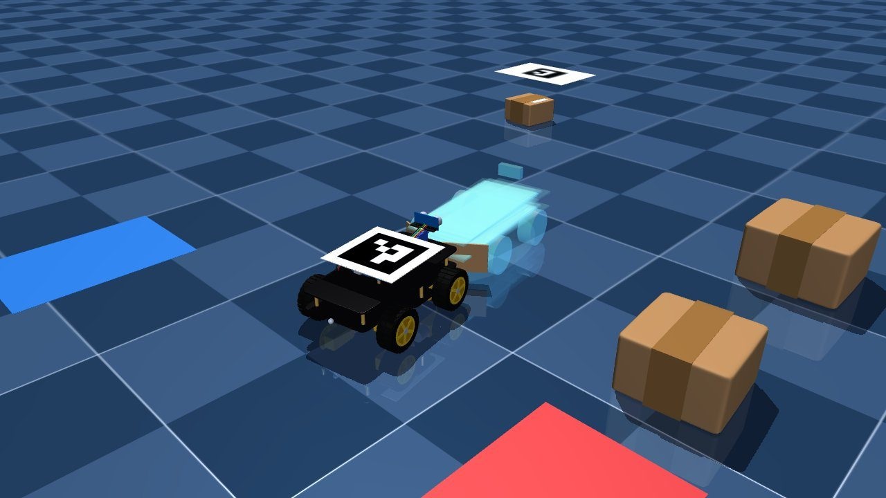
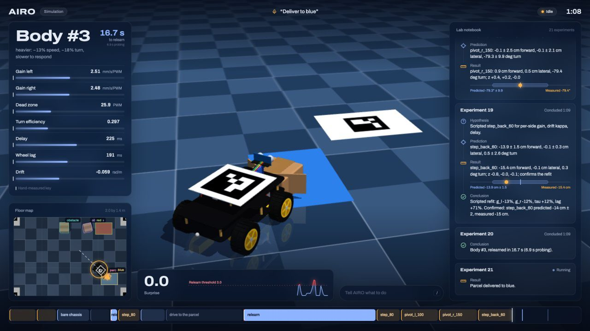

# AIRO

**Adaptive Intelligence for Robots.** A $50 robot car that learns its own body.

AIRO watches a cheap, encoder-less robot car from an overhead phone camera and learns how the car's body moves by
running physical experiments on it, like a newborn testing its limbs. It fits a seven-parameter motion model, shows
its uncertainty as a calibrated "ghost cloud" of predicted futures, and delivers parcels on voice command. When the
body changes (a weight strapped on, a box in tow, a motor wired backwards) it notices that reality has left the cloud,
runs a few targeted probes, confirms the new body with a prediction it then tests, and carries on. Meta's models plan
the experiments, look at the scene and write the lab notebook; they are never inside the 20 Hz control loop.




## Run it

```sh
uv sync
uv run scripts/demo.py --mujoco      # physics twin with the 3D chase view; open http://127.0.0.1:8000
uv run scripts/demo.py --sim         # lightweight model-exact simulator
uv run scripts/demo.py --floor W H --marker-h 0.1           # the real car (see Setup)
uv run scripts/demo.py --floor W H --marker-h 0.1 --dry     # camera, pose and dashboard, nothing drives
```

Type into the dashboard's command bar or the terminal: `learn`, `deliver to blue` (or `red`), `status`, `stop`; with
`--voice`, say them. In simulation, `weight`, `tow`, and on `--mujoco` also `slippery` and `flip`, change the body
mid-run. For the Meta models put a `MODEL_API_KEY` in `.env` and run `uv run --env-file .env scripts/demo.py …`;
without it a scripted scientist runs a fixed probe schedule. Either way every number comes from the fit, never from
a language model.

Other entry points: `scripts/learn.py` (the learning gate: fit vs the hand-measured key, ±2σ, cloud radius per probe),
`scripts/goto.py` (click a point, the car drives there), `scripts/eval.py` (the benchmark below; `--wonder` runs it
with the live scientist).

## Meta models

| Model | Role |
|---|---|
| `muse-wonder-1.0` | The scientist: picks each probe, states a falsifiable hypothesis, refits, concludes and names the body. Tools return every number; it never steers. |
| `muse-spark-1.3` | Looks at the camera frame when the body changes ("a weight pack strapped on top") to inform the hypothesis. |
| `sam-3.1` | Segments the floor scene: parcel, stations and boxes become polygons and an occupancy grid for the planner. |
| `muse-voice-transcribe-1.0` | Realtime speech to commands; the text bar is the fallback. |
| `muse-image-1.0` | A self-portrait of each confirmed body for the body card. |

## Architecture

- `airo/protocol.py`: CMD/SENS bytes of the car firmware
- `airo/car.py`: asyncio BLE link, one reconnect on drop
- `airo/camera.py`: ArUco floor homography and car pose
- `airo/rig.py`: 20 Hz loop over car and camera with a safety envelope and jsonl logs; shared CLI flags
- `airo/sim.py`: model-exact simulated rig and floor world; `airo/mjsim.py`: MuJoCo twin with contact physics
- `airo/body.py`: the body model, rollout, fit with sign search, Laplace posterior, surprise, inverse
- `airo/control.py`: delay-compensated pure pursuit, goto, follow, face
- `airo/probes.py`: probe library, free-space check, predicted vs measured outcomes
- `airo/scientist.py`: Wonder tool loop and scripted fallback, verified relearn, lab notebook
- `airo/planner.py`: SAM masks to a floor grid, A* with clearance, push poses
- `airo/mission.py`: commands in, deliveries out; surprise monitor, relearn, dashboard state
- `airo/server.py`: dashboard server (state websocket, video streams, portrait); `web/`: the page
- `airo/meta_api.py`: SAM, Spark, Wonder and Image clients; `airo/voice.py`: realtime transcription and intents
- `airo/portrait.py`: Muse Image self-portrait prompts

## Hardware

Elegoo Smart Robot Car V4 (Arduino UNO, 4 TT motors, skid steer, no encoders), HM-10 BLE module ("HC-05"), and
an iPhone as an overhead camera (~1.8 m) via Continuity Camera.

## Setup

```sh
uv sync
cp .env.example .env              # add MODEL_API_KEY
uv run scripts/markers.py         # A4 pages in data/markers, print at 100%
```

Floor frame: tape corner markers 1–4 counter-clockwise (1 → 2 is +x, 1 → 4 is +y), all with their top edge
toward +y, and measure the centre-to-centre distances W and H. Tape marker 0 flat on the car, top edge forward.
Stations are a red and a blue A4 sheet, the parcel is a small box wrapped in yellow, obstacles are plain boxes; the
planner asks SAM for "red rectangle", "blue rectangle", "yellow box" and "box".
On the phone, turn off Center Stage, Portrait and Studio Light; auto-cropping breaks the floor homography.

## Day-1 checks

| Check | Command | Pass |
|---|---|---|
| Pose | `uv run scripts/pose_check.py --floor W H --marker-h 0.1 --show` | ≥15 Hz, residual and still-car jitter ≤10 mm |
| Dry run | `uv run scripts/goto.py --floor W H --marker-h 0.1 --dry` | pose arrow on the car; clicks print floor coordinates that match a tape measure |
| BLE | `uv run scripts/drive_check.py` | drives straight then pivots, ack ≈66 ms, SENS ≈25 Hz |
| Meta API | `uv run --env-file .env scripts/bench_api.py --concept box` | latency printed, overlay in `data/` looks right |
| Offline | `uv run pytest` | geometry, protocol and SAM parsing tests pass |

## Uncertainty

The ghost cloud is a Laplace posterior around the fitted body with a broad physical prior; a parameter keeps its
prior spread until some probe has excited it (eta and drift need a turn, the dead zone a command near it). The noise
variance is inflated by 14 × the residuals' autocorrelation time, calibrated on held-out probes in simulation: over
30 seeds the true outcome falls within 2σ of the prediction 87–100% of the time (93/87/100% for x/y/heading with
all probes, 100/100/97% with four), and the true parameters 87–100%, except the dead zone at 73% when only four probes
are available.

## Measured numbers

**Simulation** (`uv run scripts/eval.py --n 10 --rig sim|mujoco`, scripted scientist, no API; hardware numbers to
follow). Each seed learns once, then delivers with the body changed 0.3 m into the transit.

| | SimRig (model-exact) | MuJoCo twin (physics) |
|---|---|---|
| Learn: 10 probes, cloud radius | 0.3 cm, parameters within 7% of truth | 1.1 cm |
| Held-out probes within 2σ | 100% | 100% |
| False surprise triggers (50 runs) | 0 | 0 |
| Weight: detected / confirmed / delivered | 10/10 at 1.0 s, 9/10, 10/10 (gains −35%) | 10/10 at 6.1 s, 10/10, 10/10 (0.8 kg) |
| Tow: detected / confirmed / delivered | 2/10, 2/2, 10/10 (gains −15%, lag ×2) | 10/10 at 1.6 s, 9/10, 10/10 |
| Slippery floor: detected / confirmed / delivered | 10/10 at 4.9 s, 10/10, 10/10 | 0/10, –, 10/10 (a 0.4 × 0.5 m patch) |
| Reversed left motor: detected / identified / confirmed / delivered | 10/10 at 1.0 s, 10/10, 0/10, 10/10 | 10/10 at 1.1 s, 10/10, 0/10, 10/10 |
| Parcel distance from the station centre (clean) | 5.8 cm median | 8.1 cm median |

A relearn must confirm in every regime the surprise happened in: a pivot or arc if the car was turning, a step if it
was driving straight, each predicted tightly (±3 cm, ±6°) and within 2σ. With the 0.8 kg weight the twin relearns
once and names it "heavier: −12% speed, −25% turn". Relearning finds a reversed motor by restarting the fit with each
gain's sign flipped and says so ("the left motor runs backwards"), but five probes leave that fit too loose to confirm
straight driving, so it is reported as partial. A towed box is a drag force the body model has no term for; its
slack string in reverse and its swing in pivots stay unmodelled. An unconfirmed relearn continues at 0.6× speed; one
no fit can explain stops with a hardware-fault alert.

## Limitations

- All numbers so far are from simulation; hardware runs are next.
- The body model has seven parameters and no term for drag, slip or battery sag. A towed box's relearn is confirmed
  on a forward step only. Changes under ~8% speed (0.4 kg on the twin) and the twin's small slippery patch go
  unnoticed; the 0.8 kg weight is only caught in the turns near the parcel.
- A reversed motor is identified and driven around, but its relearn stays partial: confirming both turning and
  straight driving within five probes needs a tighter fit than the window gives.
- Drift is weakly identifiable; the learning gate reports its sign as undetermined when it is within 2σ of zero.
- The uncertainty inflation is calibrated in simulation; on hardware only its autocorrelation factor adapts.
- Probes check free floor, not obstacles, so learning needs a clear centre band; pushes are kept straight because a
  curved push slides the parcel off the bumper.
- The benchmark uses the scripted scientist for repeatability. Live, on the twin: Wonder runs a 6-probe learn and a
  weight relearn (confirmed in 2 probes) and names the body itself; SAM's scan puts the parcel within 1 cm; Voice
  turns a spoken "deliver the parcel to blue" into the intent.

## Hackathon disclosure

Built for the Meta Global AI Developer Hackathon, Oct 26 – Nov 4 2026.

- **Built during the event:** everything in this repository.
- **Pre-existing:** the car's Arduino firmware from
  [airo7/sim2real-robot-car](https://github.com/airo7/sim2real-robot-car) (`hardware/arduino/main/main.ino`),
  used unchanged. `airo/protocol.py` reimplements its CMD/SENS byte layout so this repo can talk to it.
  Nothing else is copied.
- **Meta models:** `muse-wonder-1.0`, `muse-spark-1.3`, `sam-3.1`, `muse-voice-transcribe-1.0`, `muse-image-1.0`.

## License

MIT
