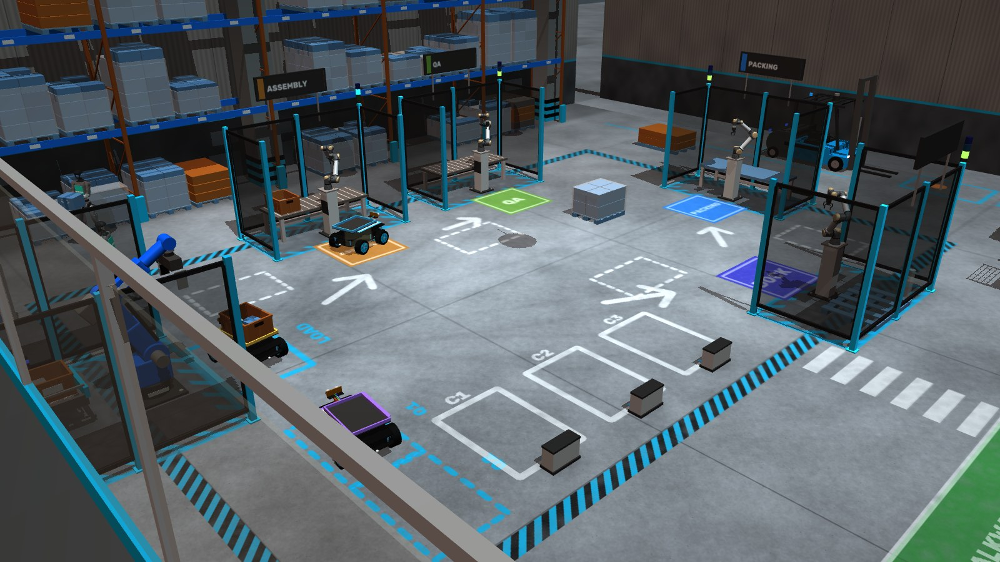
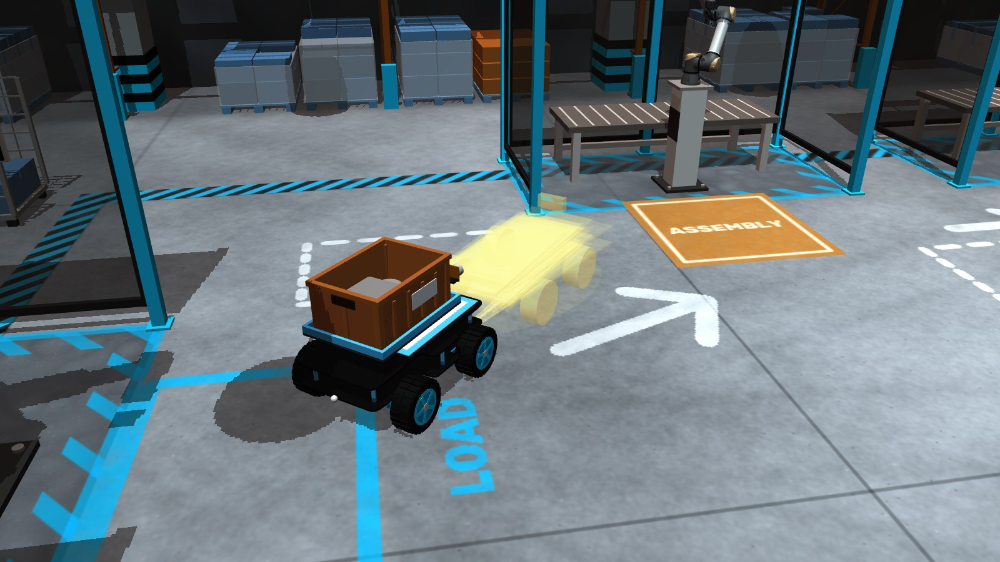

# AIRO

**A $50 robot that learns its own body, and a fleet that shares what it learned.**

AIRO starts with a cheap, encoder-less robot car and an overhead camera. It does not know how fast the car goes, how
late it responds or how well it turns, so it finds out the way a newborn tests its limbs: it runs small physical
experiments, fits a seven-parameter body model, and draws its uncertainty as a ghost cloud of predicted futures.
Then it goes to work. When reality leaves the cloud (a weight strapped on, a box in tow, a motor wired backwards) it
notices, probes, confirms a new body with a prediction it then tests, and carries on.

Every body it has been goes into a memory the whole fleet shares. A car that meets a known body again (a heavy tote
another car already learned) recalls it with one probe in about 2 seconds instead of relearning. In the factory twin,
three cars fetch heavy and light totes that robot arms load onto them, feel each new body at the cell, and deliver
across a living warehouse with workers walking, a forklift working and goods dropping in the aisles.

Meta's models plan the experiments, look at the car, name the bodies and take voice commands. They are never inside
the 20 Hz control loop: every number comes from the fit.




## What it does

- **Learns its body.** Ten probes (steps, pivots, arcs, a ramp, a pulse) fit gains, dead zone, delay, wheel lag,
  turn efficiency and drift, with a calibrated Laplace posterior. The ghost cloud is that posterior rolled forward.
- **Notices change.** Each half-second window is scored against the cloud. Surprise fires when three windows run
  above threshold, or when moderate surprise persists (a capped CUSUM catches a tow on an already loaded car).
- **Relearns, verified.** Probes go where the surprise happened (turning or straight), and a relearn only counts once
  a probe it predicted tightly lands within 2σ. A refit with each gain's sign flipped finds a reversed motor.
- **Remembers.** Bodies are kept per robot model and shared by the fleet. Before relearning, a remembered body that
  explains the surprise is tried with one confirming probe. After a known load or unload, one in-place pivot decides
  "same", "recalled" or "learned", with a second pivot when two bodies explain it about equally well.
- **Works in a fleet.** Robots plan around each other, queue for bays, give way to people and the forklift, and plan
  around dropped pallets and cartons. Commands address one robot ("airo 2 …") or the selected one.
- **Talks.** Voice or the command bar: `airo 2 bring a heavy tote to packing`, `select airo 3`, `send a worker
  across`, `drop a carton`, `jam at packing`, `spill`, `busy`.

## Run it

```sh
uv sync
uv run scripts/fetch_models.py      # optional: UR5e, Robotiq 2F-85 and Unitree G1 from MuJoCo Menagerie
uv run --env-file .env scripts/demo.py --site factory --busy normal   # the warehouse fleet; http://127.0.0.1:8000
uv run scripts/demo.py --mujoco     # one car on the home floor's physics twin, with the 3D chase view
uv run scripts/demo.py --sim        # lightweight model-exact simulator
uv run scripts/demo.py --floor W H --marker-h 0.1          # the real car (see Setup); add --dry to drive nothing
```

Without a `MODEL_API_KEY` in `.env` a scripted scientist runs a fixed probe schedule and the twins segment their own
frames; with it, Muse Wonder runs the experiments and SAM reads the camera. In the factory: `deliver to qa`,
`bring a light tote to dock`, `learn`, `stop`, `weight`, `tow`, `flip`, `remove weight`, `clean`, `calm`, `pause`,
`speed 0.5`; `--voice` takes them spoken. The 3D view orbits, zooms, names a clicked part and has chase, iso, top,
floor and deck (the mezzanine) presets.

Other entry points: `scripts/learn.py` (learn and gate a body against the hand-measured key), `scripts/goto.py`
(click a point, the car drives there), `scripts/eval.py` (the benchmark below; `--wonder` uses the live scientist).

## Meta models

| Model | Role |
|---|---|
| `muse-wonder-1.0` | The scientist: picks each probe with a falsifiable hypothesis, recalls a remembered body or relearns, concludes and names the body. Tools return every number; it never steers. A 12 s budget per relearn, then the scripted policy finishes. |
| `muse-spark-1.3` | Looks at the car when the body changes ("a weight pack strapped on top"), in parallel with Wonder's first turn. |
| `sam-3.1` | Segments the floor: parcel or totes, stations and obstacles become polygons and an occupancy grid. |
| `muse-voice-transcribe-1.0` | Realtime speech to commands; the text bar is the fallback. |
| `muse-image-1.0` | A self-portrait of each confirmed body for its memory card. |

## How it works

- **Car and camera:** `protocol.py` (firmware bytes), `car.py` (BLE), `camera.py` (ArUco floor homography and pose),
  `rig.py` (20 Hz loop with a safety envelope and jsonl logs).
- **Body:** `body.py` (model, rollout, fit with sign search, Laplace posterior, surprise), `probes.py` (probe
  library, free-space check, predicted vs measured outcomes), `scientist.py` (Wonder tool loop, scripted fallback,
  verified relearn, `check_body`, lab notebook), `memory.py` (the shared body library and recall matching).
- **Driving:** `control.py` (delay-compensated pure pursuit), `planner.py` (SAM masks to a grid, A* with clearance),
  `mission.py` (deliveries and the carry workflow, surprise monitor, dashboard state), `fleet.py` (robots, command
  routing, give-way guard).
- **Twin:** `world.py` and `mjsim.py` (one MuJoCo world for every car, a DC-motor model per wheel), `sim.py` (the
  model-exact simulator), `scene.py`, `hall.py`, `mezzanine.py` (the factory hall), `warehouse.py` (totes, conveyor,
  bays, queues), `loader.py` and `cobot.py` (pick and station arms), `life.py`, `workers.py`, `forklift.py`,
  `walkmap.py` (people, the forklift and floor events), `orbit.py` (the interactive camera).
- **Interface:** `server.py` and `web/` (dashboard), `meta_api.py` (Meta model clients and the model feed),
  `voice.py`, `portrait.py`.

Tuning constants, their values and where each came from: [docs/tuning.md](docs/tuning.md).

## Threading model

- **One event loop per process.** `demo.py` runs on a single asyncio loop: the dashboard (uvicorn), the fleet
  publishing state at 10 Hz, each robot's mission stepping its rig at 20 Hz, the ticker that paces MuJoCo by the wall
  clock, the 3D view at 24 fps and voice.
- **Threads only hand data over.** On the real car a daemon thread grabs camera frames and tracks the marker; the
  loop reads its latest pose. Typed commands come from a daemon stdin thread and microphone audio from the sound
  card's callback, both through `loop.call_soon_threadsafe`. Body fits run in `asyncio.to_thread` (numpy only).
- **There is no render thread.** Every MuJoCo renderer (overhead camera, SAM stand-in, 3D view) is created, used and
  closed on the event-loop thread; the dashboard's `/camera` handler queues its request for the 3D view loop instead
  of rendering itself.
- **`show.py` separates by process.** The warehouse and the live car are two child `demo.py` processes, each with its
  own loop, GL contexts and BLE link; `show.py` serves the tab page from a small threaded HTTP server. On Ctrl+C it
  sends each child one SIGTERM so it can close BLE, and kills the process group only after 20 s.

Two rules prevent the crashes: a MuJoCo GL context must be freed on the thread that made it, or it segfaults (so
never render through `to_thread` or an executor, and `tests/conftest.py` collects garbage after each test rather
than on a `TestClient` worker thread); and threads off the loop are daemons, because `asyncio.run` waits for
executor threads at exit and one blocked on stdin would keep the process and its BLE link alive.

## Measured numbers

**Simulation** (`uv run scripts/eval.py --n 10 --rig sim|mujoco`, scripted scientist, no API; hardware numbers to
follow). Each seed learns once, then delivers with the body changed 0.3 m into the transit. The memory rows patrol a
loop instead: weight on, off, and on again.

| | SimRig (model-exact) | MuJoCo twin (physics) |
|---|---|---|
| Learn: 10 probes, cloud radius | 0.3 cm, parameters within 7% of truth | 1.1 cm |
| Held-out probes within 2σ | 100% | 100% |
| False surprise triggers (70 runs, bare and loaded) | 0 | 0 |
| Weight: detected / confirmed / delivered | 10/10 at 1.1 s, 10/10, 10/10 (gains −35%) | 10/10 at 6.5 s, 10/10, 10/10 (0.8 kg) |
| Tow: detected / confirmed / delivered | 4/10, 4/4, 10/10 (gains −15%, lag ×2) | 10/10 at 1.7 s, 10/10, 10/10 |
| Tow on a loaded car: detected / confirmed / delivered | 0/10, –, 10/10 | 10/10 at 2.4 s, 8/10, 10/10 |
| Slippery floor: detected / confirmed / delivered | 10/10 at 6.0 s, 10/10, 10/10 | 0/10, –, 10/10 (a 0.4 × 0.5 m patch) |
| Reversed left motor: detected / confirmed / delivered | 10/10 at 1.1 s, 9/10, 10/10 | 10/10 at 1.1 s, 10/10, 10/10 |
| Parcel distance from the station centre (clean) | 5.8 cm median | 8.1 cm median |
| Memory: weight on → relearn #2, off → recall #1, on → recall #2 | 10/10, 10/10, 10/10 | 10/10, 10/10, 10/10 |
| Recall vs relearn, sim time | 2.1 s and 1 probe vs 3.7 s and 2 probes | same |

**Factory carry** (`uv run scripts/eval.py --rig mujoco --changes carry --n 5 [--busy calm]`): three robots each
fetch six heavy (0.8 kg) and light (0.2 kg) totes; every check after a load or unload is graded against the real load.

| | normal warehouse | calm warehouse |
|---|---|---|
| Heavy tote: right body (learned / recalled), median check | 41/41 (5 / 36), 2.1 s | 45/45 (5 / 40), 2.1 s |
| Light tote: right body, all "same", median check | 40/40, 3.7 s | 45/45, 3.7 s |
| Unloaded: right body (same / recalled), median check | 81/81 (40 / 41), 2.1 s | 90/90 (45 / 45), 2.1 s |
| Surprise relearns (none are real changes here) | 0 | 0 |
| Delivered | 81/90 (one run's robots could not reach their bays) | 90/90 |

The first heavy load of each run is learned at the cell in about 12 s; every later one, on any robot, is recalled.
After these runs the fleet's gridlock was fixed (planning around the forklift and dropped goods, giving way to
people): 10 stress runs from calm to busy delivered 180/180 with no give-ups.

## Uncertainty

The ghost cloud is a Laplace posterior around the fitted body with a broad physical prior; a parameter keeps its
prior spread until some probe has excited it (eta and drift need a turn, the dead zone a command near it). The noise
variance is inflated by 14 × the residuals' autocorrelation time, calibrated on held-out probes in simulation: over
30 seeds the true outcome falls within 2σ of the prediction 87–100% of the time. Probes are scored against the
commands the rig actually ran, so a late tick does not read as a changed body, and a probe that ran into something
is left out of a learn.

## Hardware and setup

Elegoo Smart Robot Car V4 (Arduino UNO, 4 TT motors, skid steer, no encoders), HM-10 BLE module, and an iPhone as an
overhead camera (~1.8 m) via Continuity Camera.

```sh
cp .env.example .env              # add MODEL_API_KEY
uv run scripts/markers.py         # A4 pages in data/markers, print at 100%
```

Tape floor markers 1–4 counter-clockwise (1 → 2 is +x, 1 → 4 is +y), top edges toward +y, and measure the
centre-to-centre distances W and H; tape marker 0 on the car, top edge forward. Stations are red and blue A4 sheets,
the parcel a box wrapped in yellow. On the phone, turn off Center Stage, Portrait and Studio Light.

| Day-1 check | Command | Pass |
|---|---|---|
| Pose | `uv run scripts/pose_check.py --floor W H --marker-h 0.1 --show` | ≥15 Hz, jitter ≤10 mm |
| Dry run | `uv run scripts/goto.py --floor W H --marker-h 0.1 --dry` | clicks print floor coordinates that match a tape measure |
| BLE | `uv run scripts/drive_check.py` | drives straight then pivots, ack ≈66 ms |
| Meta API | `uv run --env-file .env scripts/bench_api.py --concept box` | latency printed, overlay looks right |
| Offline | `uv run pytest` | passes |

## Limitations

- All numbers are from simulation; hardware runs are next.
- The body model has seven parameters and no term for drag, slip or battery sag. Changes under ~8% speed and the
  twin's small slippery patch go unnoticed, and in the model-exact simulator a tow on a loaded car stays below the
  sustained-surprise allowance.
- A light tote sits between the bare and heavy bodies, so its check usually takes a second pivot (3.7 s).
- Drift is weakly identifiable; the learning gate reports its sign as undetermined within 2σ of zero.
- The uncertainty inflation is calibrated in simulation; on hardware only its autocorrelation factor adapts.
- Muse Wonder takes 6–20 s per turn, so live it often gets one turn of its 12 s budget before the scripted policy
  finishes a relearn; the benchmark uses the scripted scientist for repeatability.

## Hackathon disclosure

Built for the Meta Global AI Developer Hackathon, Oct 26 – Nov 4 2026.

- **Built during the event:** everything in this repository.
- **Pre-existing:** the car's Arduino firmware from
  [airo7/sim2real-robot-car](https://github.com/airo7/sim2real-robot-car) (`hardware/arduino/main/main.ino`),
  used unchanged. `airo/protocol.py` reimplements its CMD/SENS byte layout so this repo can talk to it.
  Nothing else is copied.
- **Third-party robot models:** the UR5e arm, Robotiq 2F-85 gripper and Unitree G1 humanoid in the factory scene come
  from [MuJoCo Menagerie](https://github.com/google-deepmind/mujoco_menagerie) under their own licences, fetched by
  `uv run scripts/fetch_models.py` into the git-ignored `third_party/`; without them the scene falls back to our own arm.
  The car model, the pick-cell arm, the warehouse, the forklift and everything else in the scene were built for this
  project.
- **Meta models:** `muse-wonder-1.0`, `muse-spark-1.3`, `sam-3.1`, `muse-voice-transcribe-1.0`, `muse-image-1.0`.

## License

MIT
