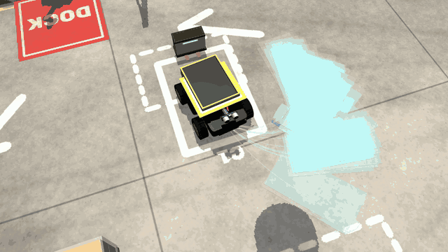
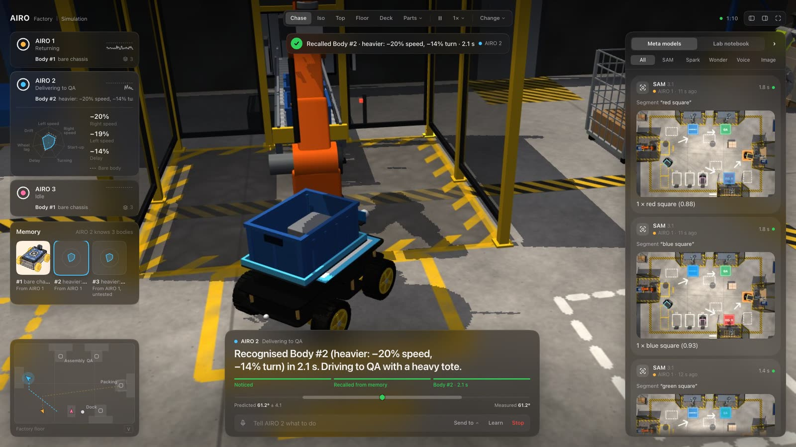
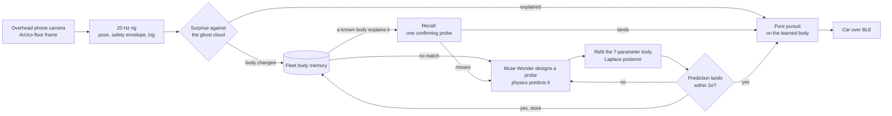

# AIRO: Adaptive Intelligence for Robots

**A $50 robot car that notices when its body changes, runs its own experiments, and only trusts a new body model
once a prediction lands. Every body it learns is shared with the fleet.**

By PiSpace, for the Meta Global AI Developer Hackathon 2026.
Site and technical write-up: **[airo7.github.io/airo-meta](https://airo7.github.io/airo-meta/)**
Demo film (3 min): **[youtu.be/ZUiLA-e9oUQ](https://youtu.be/ZUiLA-e9oUQ)** · Raw real-car footage, no edits but
the pauses: **[docs/media/raw.mp4](docs/media/raw.mp4)**

  



## The problem

Every robot drives by a model of its own body, tuned once by an engineer. Then it carries a heavy tote, tows a cart,
its tyres wear or its battery sags: the model is wrong, and the robot stops short or drifts without knowing it.
Today the fix is a service call, and over a robot's life setup, tuning and upkeep cost more than the robot itself.

## What AIRO does

One overhead phone camera, an encoder-less skid-steer car, and a loop that keeps checking itself:

1. **Notices.** Every half second the car's motion is scored against a calibrated ghost cloud of predicted futures.
   When reality leaves the cloud, the body changed.
2. **Experiments.** Muse Wonder designs each probe (a step, a pivot, an arc) with a falsifiable hypothesis, and the
   physics model predicts its outcome before the wheels turn.
3. **Refits.** A seven-parameter body model (per-side gain, dead zone, delay, wheel lag, turn efficiency, drift) is
   fitted to what the camera saw, with a Laplace posterior that becomes the new cloud.
4. **Verifies.** A relearn only counts once a tight prediction lands within 2σ.
5. **Remembers.** Each body goes into a memory the whole fleet shares. A robot that meets a known body (a heavy tote
   another robot already learned) recalls it with one probe in about 2.1 s instead of relearning.
6. **Listens.** Plain words in (Muse Spark), voice (Muse Voice Transcribe), the floor read by SAM 3.1, and a
   self-portrait of each body (Muse Image). None of them sit inside the 20 Hz control loop: every number comes from
   the fit.



## Try it in 60 seconds (no API key)

The factory twin runs three cars in a MuJoCo warehouse with robot arms loading totes, workers walking and a forklift
working. It needs [uv](https://docs.astral.sh/uv/), which fetches Python 3.13.

```sh
git clone https://github.com/airo7/airo-meta && cd airo-meta
uv sync
uv run scripts/demo.py --site factory      # open http://127.0.0.1:8000
```

Without a `MODEL_API_KEY` a scripted scientist runs a fixed probe schedule and the twin segments its own frames, so
everything works offline; the Meta models panel stays empty. `uv run scripts/fetch_models.py`
adds the UR5e arm, Robotiq gripper and Unitree G1 workers from MuJoCo Menagerie (without them the scene uses its own
arm and leaves the workers out). The body memory lives in the git-ignored `data/`, so a fresh clone starts from the
prior body.

Type into the command bar (or stdin):

| Command | What happens |
|---|---|
| `airo 2 bring a heavy tote to packing` | An arm loads a 0.8 kg tote, the car checks its new body with a pivot, then delivers |
| `deliver to qa`, `bring a light tote to dock` | The selected robot fetches and delivers |
| `select airo 3`, `learn`, `stop` | Pick a robot, make it learn its body, stop it |
| `weight`, `tow`, `flip`, `remove weight` | Change the selected robot's body mid-run: weight pack, towed load, reversed motor |
| `send a worker across`, `drop a carton`, `jam at packing`, `spill`, `clean` | Things the fleet has to plan around |
| `calm`, `normal`, `busy`, `pause`, `speed 0.5` | How lively the floor is, and the clock |

`--voice` takes the same commands spoken. The 3D view orbits, zooms, names a clicked part and has chase, iso, top,
floor and deck (the mezzanine) presets.

## How it works



| Piece | Where | In one line |
|---|---|---|
| Body model | `airo/body.py` | Seven parameters, rollout, least-squares fit with delay restarts and motor-sign search, Laplace posterior, surprise score |
| Scientist | `airo/scientist.py` | Wonder tool loop with a scripted fallback, verified relearn, `check_body` after a load, lab notebook |
| Memory | `airo/memory.py` | One JSON library per robot model, shared by the fleet; recall matching by surprise |
| Mission | `airo/mission.py` | Deliveries and the carry workflow; the surprise monitor (median of three windows, plus a CUSUM for slow changes) |
| Planner, control | `airo/planner.py`, `airo/control.py` | SAM masks to a 2 cm occupancy grid, A* with clearance; delay-compensated pure pursuit |
| Twin | `airo/world.py`, `airo/mjsim.py` | One MuJoCo world for every car, a DC-motor model per wheel, totes welded on so their mass loads the car |

The full write-up (the equations, the confirmation rule, recall, the twin and the threading model) is at
[airo7.github.io/airo-meta/how-it-works.html](https://airo7.github.io/airo-meta/how-it-works.html). Every tuning
constant, its value and where it came from: [docs/tuning.md](docs/tuning.md).

<details>
<summary>Module map</summary>

- **Car and camera:** `protocol.py` (firmware bytes), `car.py` (BLE), `camera.py` (ArUco floor homography and pose),
  `rig.py` (20 Hz loop with a safety envelope and jsonl logs), `eye.py` (where the turning centre sits relative to
  the marker), `floorwatch.py` (objects dropped on the real floor, against the empty floor as first seen).
- **Body:** `body.py` (model, rollout, fit with sign search, Laplace posterior, surprise), `probes.py` (probe
  library, free-space check, predicted vs measured outcomes), `scientist.py` (Wonder tool loop, scripted fallback,
  verified relearn, `check_body`, lab notebook), `memory.py` (the shared body library and recall matching).
- **Driving:** `control.py` (delay-compensated pure pursuit), `planner.py` (SAM masks to a grid, A* with clearance),
  `geometry.py` (footprints and overlap), `mission.py` (deliveries and the carry workflow, surprise monitor,
  dashboard state), `fleet.py` (robots, command routing, give-way guard).
- **Twin:** `world.py` and `mjsim.py` (one MuJoCo world for every car, a DC-motor model per wheel), `sim.py` (the
  model-exact simulator), `scene.py`, `hall.py`, `mezzanine.py` (the factory hall), `site.py` (floors, stations and
  their SAM concepts), `meshes.py` (procedural meshes), `menagerie.py` (UR5e, Robotiq 2F-85 and G1 from MuJoCo
  Menagerie), `warehouse.py` (totes, conveyor, bays, queues), `loader.py` and `cobot.py` (pick and station arms),
  `life.py`, `workers.py`, `forklift.py`, `walkmap.py` (people, the forklift and floor events), `orbit.py` (the
  interactive camera).
- **Interface:** `server.py` and `web/` (dashboard), `meta_api.py` (Meta model clients and the model feed),
  `voice.py`, `commander.py` (Spark turns a command into tool calls), `portrait.py`.

</details>

<details>
<summary>Threading model</summary>

- **One event loop per process.** `demo.py` runs on a single asyncio loop: the dashboard (uvicorn), the fleet
  publishing state at 10 Hz, each robot's mission stepping its rig at 20 Hz, the ticker that paces MuJoCo by the wall
  clock, the 3D view at 24 fps and voice.
- **Threads only hand data over.** On the real car a daemon thread grabs camera frames and tracks the marker; the
  loop reads its latest pose. Typed commands come from a daemon stdin thread and microphone audio from the sound
  card's callback, both through `loop.call_soon_threadsafe`. Body fits run in `asyncio.to_thread` (numpy only).
- **There is no render thread.** Every MuJoCo renderer (overhead camera, SAM stand-in, 3D view) is created, used and
  closed on the event-loop thread; the dashboard's `/camera` handler queues its request for the 3D view loop instead
  of rendering itself.
- **`show.py` separates by process.** The warehouse and the live car are two child `demo.py` processes, each with its
  own loop, GL contexts and BLE link; `show.py` serves the tab page from a small threaded HTTP server. On Ctrl+C it
  sends each child one SIGTERM so it can close BLE, and kills the process group only after 20 s.

Two rules prevent the crashes: a MuJoCo GL context must be freed on the thread that made it, or it segfaults (so
never render through `to_thread` or an executor, and `tests/conftest.py` collects garbage after each test rather
than on a `TestClient` worker thread); and threads off the loop are daemons, because `asyncio.run` waits for
executor threads at exit and one blocked on stdin would keep the process and its BLE link alive.

</details>

## Meta models

| Model | Role |
|---|---|
| `muse-wonder-1.0` | The scientist: picks each probe with a falsifiable hypothesis, recalls a remembered body or relearns, concludes and names the body. Tools return every number; it never steers. A 12 s budget per relearn, then the scripted policy finishes. |
| `muse-spark-1.3` | Turns every typed or spoken command into tool calls (go to, turn, push, patrol, learn, say, deliver) from the robot's pose and floor; "stop" never waits for it, and the plain parser takes over offline. Also looks at the car when its body changes ("a weight pack strapped on top"), in parallel with Wonder's first turn. |
| `sam-3.1` | Segments the floor: parcel or totes, stations and obstacles become polygons and an occupancy grid. |
| `muse-voice-transcribe-1.0` | Realtime speech to commands; the text bar is the fallback. |
| `muse-image-1.0` | A self-portrait of each confirmed body for its memory card. |

Every call is shown live in the dashboard's model feed with its latency, input and output.

## Measured numbers

**Real car** (Elegoo V4, phone camera, no encoders). With a water bottle strapped on, the old body model predicted
0 cm and the car moved 17 cm; after relearning, 7 predictions in a row landed. On Nov 1 a warm-motor change was
caught and relearned in 27 s, and 3.5 min of patrol with a bottle on board raised no false alarm.
`scripts/report.py` gives a run's numbers.

**Simulation** (`uv run scripts/eval.py --n 10 --rig sim|mujoco`, scripted scientist, no API). Each seed learns
once, then delivers with the body changed 0.3 m into the transit. The memory rows patrol a loop instead: weight on,
off, and on again.

| | SimRig (model-exact) | MuJoCo twin (physics) |
|---|---|---|
| Learn: 10 probes, cloud radius | 0.3 cm, parameters within 7% of truth | 1.1 cm |
| Held-out probes within 2σ | 100% | 100% |
| False surprise triggers (70 runs, bare and loaded) | 0 | 0 |
| Weight: detected / confirmed / delivered | 10/10 at 1.1 s, 10/10, 10/10 (gains −35%) | 10/10 at 6.5 s, 10/10, 10/10 (0.8 kg) |
| Tow: detected / confirmed / delivered | 4/10, 4/4, 10/10 (gains −15%, lag ×2) | 10/10 at 1.7 s, 10/10, 10/10 |
| Tow on a loaded car: detected / confirmed / delivered | 0/10, –, 10/10 | 10/10 at 2.4 s, 8/10, 10/10 |
| Slippery floor: detected / confirmed / delivered | 10/10 at 6.0 s, 10/10, 10/10 | 0/10, –, 10/10 (a 0.4 × 0.5 m patch) |
| Reversed left motor: detected / confirmed / delivered | 10/10 at 1.1 s, 9/10, 10/10 | 10/10 at 1.1 s, 10/10, 10/10 |
| Parcel distance from the station centre (clean) | 5.8 cm median | 8.1 cm median |
| Memory: weight on → relearn #2, off → recall #1, on → recall #2 | 10/10, 10/10, 10/10 | 10/10, 10/10, 10/10 |
| Recall vs relearn, sim time | 2.1 s and 1 probe vs 3.7 s and 2 probes | same |

**Factory carry** (`uv run scripts/eval.py --rig mujoco --changes carry --n 5 [--busy calm]`): three robots each
fetch six heavy (0.8 kg) and light (0.2 kg) totes; every check after a load or unload is graded against the real load.

| | normal warehouse | calm warehouse |
|---|---|---|
| Heavy tote: right body (learned / recalled), median check | 41/41 (5 / 36), 2.1 s | 45/45 (5 / 40), 2.1 s |
| Light tote: right body, all "same", median check | 40/40, 3.7 s | 45/45, 3.7 s |
| Unloaded: right body (same / recalled), median check | 81/81 (40 / 41), 2.1 s | 90/90 (45 / 45), 2.1 s |
| Surprise relearns (none are real changes here) | 0 | 0 |
| Delivered | 81/90 (one run's robots could not reach their bays) | 90/90 |

The first heavy load of each run is learned at the cell in about 12 s; every later one, on any robot, is recalled.
After these runs the fleet's gridlock was fixed (planning around the forklift and dropped goods, giving way to
people): 10 stress runs from calm to busy delivered 180/180 with no give-ups.

### Uncertainty

The ghost cloud is a Laplace posterior around the fitted body with a broad physical prior; a parameter keeps its
prior spread until some probe has excited it (eta and drift need a turn, the dead zone a command near it). The noise
variance is inflated by 14 × the residuals' autocorrelation time, calibrated on held-out probes in simulation: over
30 seeds the true outcome falls within 2σ of the prediction 87–100% of the time. Probes are scored against the
commands the rig actually ran, so a late tick does not read as a changed body, and a probe that ran into something
is left out of a learn.

## Run modes

```sh
uv run scripts/demo.py --site factory --busy normal          # the warehouse fleet; http://127.0.0.1:8000
uv run scripts/demo.py --mujoco                              # one car on the home floor's physics twin, 3D chase view
uv run scripts/demo.py --sim                                 # lightweight model-exact simulator
uv run scripts/demo.py --floor W H --marker-h 0.1            # the real car (see below); add --dry to drive nothing
uv run --env-file .env scripts/demo.py --site factory        # with the Meta models (MODEL_API_KEY in .env)
```

Other entry points: `scripts/learn.py` (learn and gate a body against the hand-measured key), `scripts/goto.py`
(click a point, the car drives there), `scripts/eval.py` (the benchmark above; `--wonder` uses the live scientist),
`scripts/show.py` (the warehouse and the real car as two tabs behind one page), `scripts/report.py` (numbers from one
hardware run), `scripts/centre_check.py` (where the car turns about).

## Real car setup

Elegoo Smart Robot Car V4 (Arduino UNO, 4 TT motors, skid steer, no encoders), its BLE module (advertises as
HC-05), and an iPhone as an overhead camera (~1.8 m) via Continuity Camera.

```sh
cp .env.example .env              # add MODEL_API_KEY
uv run scripts/markers.py         # A4 pages in data/markers, print at 100%
```

Tape floor markers 1–4 counter-clockwise (1 → 2 is +x, 1 → 4 is +y), top edges toward +y, and measure the
centre-to-centre distances W and H; tape marker 0 on the car, top edge forward. Stations are red and blue A4 sheets,
the parcel a box wrapped in yellow. On the phone, turn off Center Stage, Portrait and Studio Light.

| Day-1 check | Command | Pass |
|---|---|---|
| Pose | `uv run scripts/pose_check.py --floor W H --marker-h 0.1 --show` | ≥15 Hz, jitter ≤10 mm |
| Dry run | `uv run scripts/goto.py --floor W H --marker-h 0.1 --dry` | clicks print floor coordinates that match a tape measure |
| BLE | `uv run scripts/drive_check.py` | drives straight then pivots, ack ≈66 ms |
| Meta API | `uv run --env-file .env scripts/bench_api.py --concept box` | latency printed, overlay looks right |
| Offline | `uv run pytest` | passes |

## Limitations

- The tables are from simulation (`scripts/eval.py`); the real-car evidence is the runs described above.
- The body model has seven parameters and no term for drag, slip or battery sag. Changes under ~8% speed and the
  twin's small slippery patch go unnoticed, and in the model-exact simulator a tow on a loaded car stays below the
  sustained-surprise allowance.
- A light tote sits between the bare and heavy bodies, so its check usually takes a second pivot (3.7 s).
- Drift is weakly identifiable; the learning gate reports its sign as undetermined within 2σ of zero.
- The uncertainty inflation is calibrated in simulation; on hardware only its autocorrelation factor adapts.
- Muse Wonder takes 6–20 s per turn, so live it often gets one turn of its 12 s budget before the scripted policy
  finishes a relearn; the benchmark uses the scripted scientist for repeatability.

## Repository layout

```
airo/        the package: body model, scientist, memory, mission, fleet, planner, MuJoCo twin, dashboard server
scripts/     entry points: demo, eval, learn, goto, show, report, markers and the day-1 checks
tests/       offline tests (uv run pytest)
web/         the live dashboard (plain HTML, CSS and JS)
docs/        the project site (GitHub Pages), tuning.md and media
```

## Why it matters

Robot purchase is 25–40% of lifetime cost; the rest is setup, tuning and upkeep (vendor estimates:
[Mecademic](https://www.mecademic.com/knowledge_base/robots-total-cost-of-ownership-tco/),
[Automation Inside](https://automationinside.com/article/total-cost-of-ownership-for-robots-and-amrs)). About 102,900
transport and logistics robots were sold in 2024
([IFR](https://ifr.org/ifr-press-releases/news/service-robots-see-global-growth-boom)), and 98.5% of US
manufacturers have fewer than 500 employees ([NAM](https://nam.org/member-services/smm-membership/)). A robot that
recalibrates itself, and shows that it did, moves the tuning job into the robot.

## Built during the hackathon

Built by PiSpace for the Meta Global AI Developer Hackathon, Oct 26 – Nov 4 2026. The first commit is from Oct 28
2026, and everything in this repository was written during the event.

- **Pre-existing:** the car's Arduino firmware from
  [airo7/sim2real-robot-car](https://github.com/airo7/sim2real-robot-car) (`hardware/arduino/main/main.ino`),
  used unchanged. `airo/protocol.py` reimplements its CMD/SENS byte layout so this repo can talk to it.
  Nothing else is copied.
- **Third-party robot models:** the UR5e arm, Robotiq 2F-85 gripper and Unitree G1 humanoid in the factory scene come
  from [MuJoCo Menagerie](https://github.com/google-deepmind/mujoco_menagerie) under their own licences, fetched by
  `uv run scripts/fetch_models.py` into the git-ignored `third_party/`; without them the scene falls back to our own
  arm. The car model, the pick-cell arm, the warehouse, the forklift and everything else in the scene were built for
  this project.
- **Meta models:** `muse-wonder-1.0`, `muse-spark-1.3`, `sam-3.1`, `muse-voice-transcribe-1.0`, `muse-image-1.0`.

## License

MIT, see [LICENSE](LICENSE).
